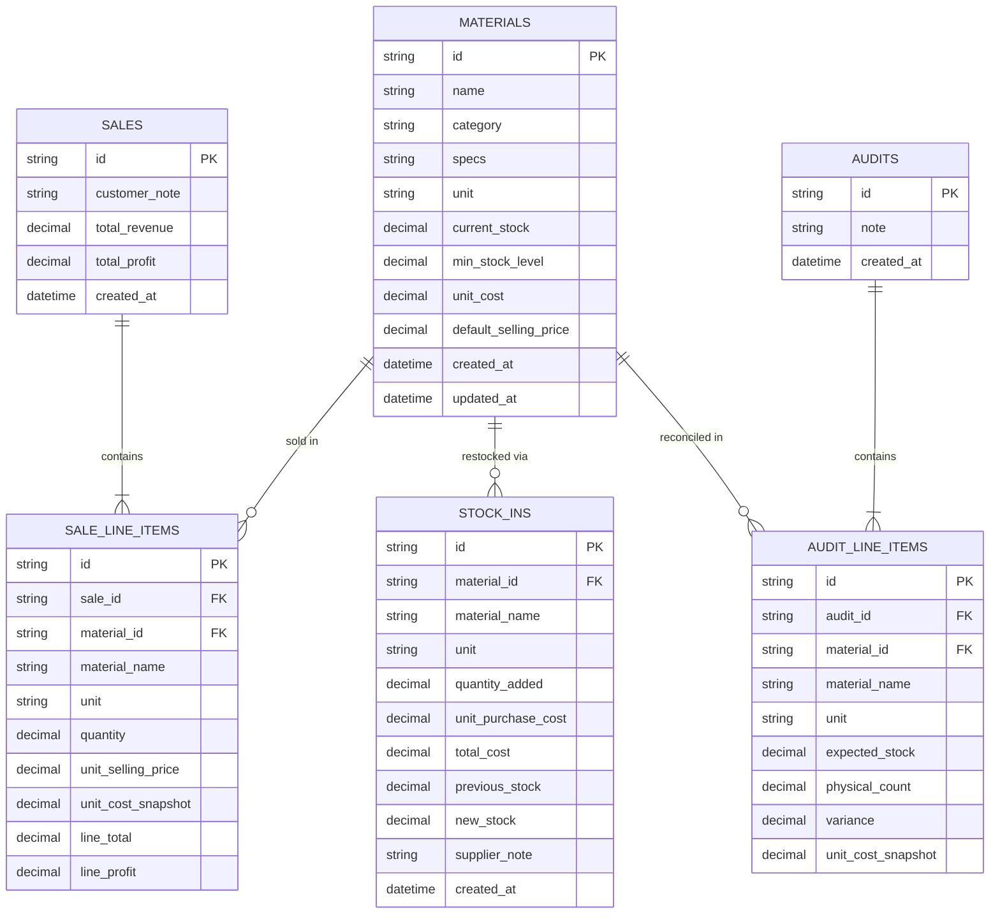

# System Technical Architecture (`ARCHITECTURE.md`)

**Project:** Construction & Finishing Material Store Mobile ERP & Inventory Management System  
**Document Version:** 1.0  
**Source of Truth References:** `PROJECT_RULES.md`, `docs/PRODUCT_BRIEF.md`, `docs/SRS.md`, `docs/DATABASE_DESIGN.md`, `docs/API_CONTRACT.md`

---

## 1. Architecture Overview

### 1.1 Architectural Style
The system follows a **Clean Layered, Domain-Driven Mobile ERP Architecture** designed for **Android (Flutter)** as the primary target client, backed by deterministic transactional persistence and an existing lightweight **Node.js / Express REST API** (`express ^4.21.2` already provisioned in the project workspace) for server-synchronized deployment or web/mobile preview.

The architecture strictly separates concerns into four layers:
1. **Presentation Layer (UI & Localization):** Mobile-first screens, trilingual localization (`English`, `Amharic / አማርኛ`, `Afan Oromo / Afaan Oromoo`), and reactive state consumers.
2. **Application / State Management Layer:** Reactive controllers/notifiers managing the multi-item POS sale cart, form validation state, and optimistic/synchronized inventory views.
3. **Domain Layer (Pure Business Rules):** Deterministic arithmetic (`ETB` currency rounding to 2 decimal places), strict stock-floor enforcement (`BR-002`), aggregate cart validation (`BR-003`), weighted-average supplier unit cost updates (`BR-006`), and physical ground-stock variance calculation (`FR-018`).
4. **Data / Persistence & API Layer:** Atomic transactional repository implementing the approved schema (`materials`, `sales`, `stock_ins`, `audits`) via local relational storage (SQLite / Drift on Android) and/or the Express REST API contract defined in `docs/API_CONTRACT.md`.

```
+-----------------------------------------------------------------------+
|                   PRESENTATION LAYER (Android / Mobile UI)            |
|  Dashboard | Material Catalog | Multi-Item POS | Stock-In | Audit     |
|                Trilingual i18n (en / am / om) + ETB Formatter         |
+-----------------------------------+-----------------------------------+
                                    |
                                    v
+-----------------------------------------------------------------------+
|                   STATE MANAGEMENT LAYER                              |
|  CatalogController | PosCartController | StockInController | AuditCtrl|
+-----------------------------------+-----------------------------------+
                                    |
                                    v
+-----------------------------------------------------------------------+
|                   PURE DOMAIN ENGINE (Business Rules)                 |
|  - Strict Stock Floor Guard (BR-002)                                  |
|  - Aggregate Multi-Item Cart Validation (BR-003)                      |
|  - Weighted-Average Supplier Cost Calculator (BR-006)                 |
|  - Physical Ground-Stock Variance Reconciler (FR-018/FR-019)          |
+-----------------------------------+-----------------------------------+
                                    |
                                    v
+-----------------------------------------------------------------------+
|                   DATA / REPOSITORY & API LAYER                       |
|  Local SQLite (Android Offline-First) <---> Express REST API (/api/*) |
+-----------------------------------------------------------------------+
```

### 1.2 Alignment Between Target Android (Flutter) & Existing Workspace Stack
Per `PROJECT_RULES.md` Section 2 (*"Follow the existing architecture. Respect existing technology choices"*):
- **Target Native Mobile Platform:** **Flutter (Android)** provides native ARM64 compilation, offline-capable SQLite persistence, and smooth 60/120fps yard/counter usability on low-to-mid-range Android devices common in Ethiopian construction supply stores.
- **Existing Workspace Runtime:** The repository currently contains an initialized **Node.js + Express (`express ^4.21.2`) + TypeScript + React/Vite** environment. Rather than discarding the existing Express server setup, the backend contract (`docs/API_CONTRACT.md`) and database schema (`docs/DATABASE_DESIGN.md`) are designed to be **100% shared** between the Express backend and the Flutter client repository interface.

---

## 2. Technology Choices & Trade-Off Analysis

### 2.1 Frontend Framework: Flutter (Target Android App) & Existing Mobile-First Web Preview

| Criterion | Analysis |
| :--- | :--- |
| **Why It Is Appropriate** | Construction material store operators primarily use Android phones in yards and at retail counters. Flutter compiles ahead-of-time (AOT) to native ARM machine code, renders consistent Material 3 touch targets (`>= 44x44dp`), and natively supports Ethiopic (`Ge'ez` script for Amharic) and Latin script (`English` and `Afan Oromo`) typography without WebView sluggishness. |
| **Advantages** | • Single codebase for Android APK/AAB (and optional desktop/web).<br>• High rendering performance and instant touch response for < 15s POS entry (`NFR-002`).<br>• First-class `intl` and `.arb` localization tooling for `en`, `am`, and `om`.<br>• Strong static typing with Dart 3 null safety. |
| **Disadvantages** | • Larger initial APK binary size (~15–20 MB) compared to pure Kotlin.<br>• Requires Flutter SDK toolchain for native APK builds outside a Node.js container. |
| **Alternatives Considered** | • **Kotlin + Jetpack Compose:** Native Android standard with smaller binary size, but lacks cross-platform portability if the owner later wants a Windows counter PC or iOS build.<br>• **React Native:** Shares JavaScript/TypeScript knowledge with the existing repo, but JS bridge overhead and font/layout inconsistencies on budget Android devices are less predictable than Flutter's Skia/Impeller engine.<br>• **Progressive Web App (React/Vite in Existing Repo):** Zero install friction and runs directly in the existing AI Studio Node/Vite container, making it ideal as the interactive web preview companion while sharing the exact same REST API and domain rules. |

### 2.2 State Management: Riverpod (`flutter_riverpod`)

| Criterion | Analysis |
| :--- | :--- |
| **Why It Is Appropriate** | The app has interdependent reactive states—specifically, the Multi-Item POS Cart (`FR-006`–`FR-012`), the Material Catalog (`FR-001`–`FR-005`), and the Dashboard KPIs (`FR-020`) must stay strictly synchronized whenever a Sale, Stock-In, or Ground-Stock Audit completes. |
| **Advantages** | • Compile-safe providers with zero `BuildContext` dependency.<br>• Clean separation of pure business logic (`Notifier` / `AsyncNotifier`) for unit testing.<br>• Trivial derived state calculation (e.g., auto-computing cart `totalRevenue`, `projectedRemainingStock`, and `lowStockMaterials`). |
| **Disadvantages** | • Slight learning curve around provider families and code generation (`riverpod_annotation`) if overused. |
| **Alternatives Considered** | • **BLoC (`flutter_bloc`):** Excellent event/state traceability, but introduces excessive boilerplate (`Events`, `States`, `Mappers`) for a single-user MVP.<br>• **Provider:** Simpler, but relies on `BuildContext` and lacks Riverpod's compile-time safety for combining asynchronous repositories. |

### 2.3 Backend & API Runtime: Existing Node.js + Express (`TypeScript`)

| Criterion | Analysis |
| :--- | :--- |
| **Why It Is Appropriate** | `express ^4.21.2` and `tsx ^4.21.0` are already installed in `package.json`. Using the existing Express runtime avoids unnecessary rewrites while providing a clean REST boundary (`/api/*`) that validates every transaction server-side (`SEC-001`). |
| **Advantages** | • Zero additional infrastructure setup; already present in the project.<br>• Fast JSON serialization and deterministic validation.<br>• Allows both the Android Flutter client (via HTTP) and the browser preview client to consume the exact same validated endpoints. |
| **Disadvantages** | • Single-threaded event loop (though CPU load for single-store ERP arithmetic is negligible). |
| **Alternatives Considered** | • **NestJS / Fastify:** Unnecessary dependency bloat and architectural overhead prohibited by `PROJECT_RULES.md` Section 2.<br>• **Pure On-Device Only (No Backend API):** Works for a single phone, but maintaining the clean Express REST API contract allows local server backup and multi-client extensibility without breaking the architecture. |

### 2.4 Database Engine: SQLite (via `Drift` on Flutter / Transactional File/SQLite Store on Server)

| Criterion | Analysis |
| :--- | :--- |
| **Why It Is Appropriate** | The ERP requires strict ACID transactions (`FR-012`, `FR-015`, `FR-019`) so that multi-item sales never partially deduct stock if one line item fails validation (`FAIL-004`). |
| **Advantages** | • Full ACID transactional guarantees.<br>• Zero external cloud database latency; works reliably in construction yards with intermittent internet.<br>• Relational foreign-key enforcement between `materials` and transaction ledgers (`sale_items`, `stock_ins`, `audit_items`). |
| **Disadvantages** | • Embedded database is scoped to single-node/single-store scale (which matches `ROLE-001` Single-User requirement). |
| **Alternatives Considered** | • **Hive / SharedPreferences (Key-Value):** Lacks relational integrity and multi-table ACID transactions; high risk of corrupted stock balances.<br>• **Cloud PostgreSQL / Firebase Firestore:** Requires constant internet connectivity and external provisioning not needed for a single-user local store MVP. |

---

## 3. Frontend Design (Android / Mobile-First UX)

### 3.1 Navigation & Screen Topology
Designed for one-handed thumb operation on a mobile viewport (`360dp × 800dp` baseline) using a 5-tab bottom navigation bar:
1. **Dashboard (`DashboardScreen`):**
   - Top header with Store Title and instant Language Pill Switcher (`EN` | `አማ` | `ORO`).
   - 4 KPI Cards in `ETB`: Total Sales Revenue, Gross Profit, Inventory Value (Cost & Retail), and Low-Stock Alert Counter.
   - Quick-action buttons (`+ Record Sale`, `+ Stock-In`, `Start Ground Audit`).
   - Low-stock attention list (`currentStock <= minStockLevel`).
2. **Catalog (`MaterialsScreen`):**
   - Search bar (matches `name` or `specs`, e.g., `"12mm"`, `"Grade 60"`, `"50kg"`).
   - Horizontal category filter chips (`All`, `Rebar`, `Cement`, `Tiles`, `Paint`, `Hardware`, `Other`).
   - Material cards showing Name, Specs, Category badge, Current Stock + Unit, Unit Cost (`ETB`), and Default Selling Price (`ETB`).
   - Modal/Sheet for SKU-free Material Registration (`FR-001`) and Metadata Editing (`FR-003`, `FR-004`).
3. **POS Sale (`SalesPosScreen`):**
   - Material selector with live available stock badge.
   - Multi-item cart list: each line item displays Material Name, Unit, Quantity input, editable Unit Selling Price (`ETB`), auto-calculated `Line Subtotal (ETB)`, and live `Remaining Stock After Sale` preview.
   - **Strict Stock-Floor Guard (`FR-011`, `BR-002`):** If `Quantity > currentStock`, the line highlights in red, displays a localized error message, and disables the Confirm Sale button.
   - Sticky bottom checkout bar displaying `Total Revenue (ETB)` and `Confirm Sale` action.
4. **Stock-In (`StockInScreen`):**
   - Select Material $\rightarrow$ enter `Quantity Added (> 0)` $\rightarrow$ enter `Supplier Unit Purchase Cost (ETB >= 0)` $\rightarrow$ optional Supplier Note.
   - Live preview box showing `Total Restock Cost (ETB)`, `New Stock Balance`, and updated `Weighted-Average Unit Cost (ETB)` (`BR-006`).
5. **Ground Audit & History (`AuditAndHistoryScreen`):**
   - **Ground-Stock Audit Tab (`FR-016`–`FR-019`):** Lists materials with `Expected App Stock`. User inputs `Physical Ground Count`. System immediately displays `Variance = Physical Count - Expected Stock` (`+` surplus in green/amber, `-` shortage in red, `0` matched). Committing reconciles all entered items to 100% match physical ground stock.
   - **Transaction History Tab (`FR-021`):** Filterable chronological ledger (`All`, `Sales`, `Stock-In`, `Audits`) showing timestamps, line breakdowns, and `ETB` totals.

### 3.2 Trilingual Localization (`en`, `am`, `om`) & Currency Formatting
- All UI strings are resolved through a strongly-typed localization dictionary keyed by `LanguageCode` (`'en' | 'am' | 'om'`).
- Currency formatter standardizes all monetary outputs to `ETB #,##0.00` (e.g., `ETB 17,400.00` or `17,400.00 ብር` when Amharic is active).

---

## 4. Backend Design

### 4.1 Layered Service Architecture
The backend (`server.ts`) is structured into three internal modules:
1. **HTTP Controller / Route Layer (`/api/*`):** Parses JSON request bodies, maps routes defined in `docs/API_CONTRACT.md`, and returns structured HTTP status codes (`200`, `201`, `400`, `404`, `500`).
2. **Domain Validation & Calculation Engine (`src/domain/inventoryEngine.ts`):**
   - Pure TypeScript functions shared with automated unit tests (`node:test`).
   - Enforces `VAL-001` through `VAL-007` and `BR-001` through `BR-008`.
   - Guarantees atomic validation of multi-item sales before mutating state (`FAIL-004`).
3. **Persistence Repository Layer:** Reads and writes the state atomically so no partial writes occur on failure.

---

## 5. Database Design Summary & Entity Relationship Diagram (ERD)

*(Full field-level constraints, indexes, and SQLDDL are specified in `docs/DATABASE_DESIGN.md`.)*



---

## 6. API Endpoint Specifications Summary

*(Full request/response payloads, status codes, and validation rules are documented in `docs/API_CONTRACT.md`.)*

No speculative endpoints are invented; every endpoint maps directly to `docs/SRS.md` functional requirements:
- `GET /api/state` — Fetch complete synchronized catalog, transactions, and KPI summary (`FR-005`, `FR-020`, `FR-021`).
- `POST /api/materials` — Register a new SKU-free material (`FR-001`, `FR-002`).
- `PATCH /api/materials/:id` — Update material metadata (`name`, `category`, `specs`, `minStockLevel`, `defaultSellingPrice`) while blocking direct `currentStock` or used `unit` mutation (`FR-003`, `FR-004`, `BR-001`).
- `POST /api/sales` — Execute an atomic multi-item sale transaction with strict stock-floor blocking (`FR-006`–`FR-012`, `BR-002`, `BR-003`).
- `POST /api/stock-in` — Record incoming supplier stock with supplier unit purchase cost and weighted-average cost update (`FR-013`–`FR-015`, `BR-006`).
- `POST /api/audits` — Commit a physical ground-stock audit reconciliation (`FR-016`–`FR-019`, `BR-008`).

---

## 7. Authentication and Authorization

Per `docs/PRODUCT_BRIEF.md` (Section 5) and `docs/SRS.md` (`ROLE-001`, `EX-004`):
- **Single-User Local/Store Model:** The MVP is explicitly scoped for a single user operating the store device without multi-user login screens or remote third-party OAuth dependencies.
- **Device-Level Security:** On Android, physical access is protected by the device's OS lock screen (PIN/biometric). On the server API boundary, requests are scoped to the store instance with strict server-side payload validation (`SEC-001`).

---

## 8. Role-Based Access Control (RBAC)

- **Current MVP Scope (`ROLE-001`):** Single-role (`Store Operator`) with full permissions across Catalog, POS Sales, Stock-In, Ground-Stock Audit, and History.
- **Architectural Safeguard for Audit Integrity:** Even in single-user mode, the system enforces **operational access control on data fields** (`FR-004`, `BR-004`): no user interface or API endpoint allows overwriting `currentStock` silently via the material edit endpoint (`PATCH /api/materials/:id`). Any stock change requires creating an immutable `Sale`, `StockIn`, or `StockAudit` ledger record.

---

## 9. State Management Strategy

1. **Single Source of Truth:** The repository/server state (`materials`, `sales`, `stockIns`, `audits`) is the canonical source of truth.
2. **Derived State (Never Duplicated):** Dashboard KPIs (`totalRevenue`, `totalProfit`, `inventoryCostValue`, `inventoryRetailValue`, `lowStockCount`) and POS cart totals (`lineTotal`, `totalRevenue`, `remainingStockAfterSale`) are pure computed derivations from the canonical state, eliminating state desynchronization bugs.
3. **Preserved Draft State (`FAIL-003`, `FR-022`):**
   - Unsubmitted POS sale cart items and Ground-Stock Audit count inputs are held in dedicated draft state containers.
   - Switching language (`en` $\leftrightarrow$ `am` $\leftrightarrow$ `om`) or experiencing a transient network error never wipes out the user's in-progress sale cart or audit count inputs.

---

## 10. File Storage Strategy

- **Zero Binary Media Requirement:** Construction materials in this ERP (`rebar`, `cement`, `tiles`, `paint`, `hardware`) are identified rapidly by category icon, name, and specification badge (`Ø12mm • Grade 60`) rather than heavy product photography.
- **Structured Data Persistence:** Application data is stored in a deterministic local database file (`data/erp-store.json` on the Node.js server / SQLite `.db` file in the Android app's private application directory `getApplicationDocumentsDirectory()`).
- **Atomic Write-Through:** Server file persistence writes to a temporary file and performs an atomic rename/flush so power loss never corrupts the JSON/SQLite store.

---

## 11. Security Architecture

In compliance with `PROJECT_RULES.md` Section 5 and `docs/SRS.md` Section 14:
1. **Untrusted Client Boundary (`SEC-001`):** Every business invariant (`quantity > 0`, `quantity <= currentStock`, `price >= 0`, valid `category`/`unit` enums) is re-verified inside the backend domain engine before any state mutation occurs.
2. **Aggregate Cart Anti-Bypass (`BR-003`):** If a crafted API request submits two separate line items for the same `materialId` whose combined quantity exceeds `currentStock`, the domain engine aggregates quantities by `materialId` first and rejects the entire transaction.
3. **Input Sanitization (`SEC-003`):** All text fields (`name`, `specs`, `customerNote`, `supplierNote`, `note`) are trimmed, stripped of control characters, and bounded by maximum character lengths (`120`–`250` chars). Express JSON middleware restricts request body size to `100kb`.
4. **No Exposed Secrets (`SEC-002`):** No API keys or credentials are used or exposed in client code.

---

## 12. Error Handling Strategy

### 12.1 Structured Error Format
All domain and API errors use a deterministic structure containing a machine-readable `code`, a default message, and optional `details` (such as `materialId`, `requested`, and `available` stock) so the frontend can render accurate localized messages in **English**, **Amharic**, or **Afan Oromo**:

```json
{
  "error": {
    "code": "INSUFFICIENT_STOCK",
    "message": "Requested quantity (16) for Porcelain Floor Tile 60x60 exceeds available stock (15).",
    "details": {
      "materialId": "mat_03",
      "materialName": "Porcelain Floor Tile 60x60",
      "requested": 16,
      "available": 15,
      "unit": "boxes"
    }
  }
}
```

### 12.2 UI Error Presentation
- **Zero Native Dialog Blocking (`SEC-004`, `NFR-005`):** Never uses `window.alert`, `window.confirm`, or `window.open`.
- **Inline Contextual Feedback:** Validation errors appear directly next to the offending cart line or input field, accompanied by a dismissible status banner in the active language (`en`/`am`/`om`).

---

## 13. Deployment Design

### 13.1 Android App Deployment (Flutter Target)
- **Build Artifact:** Release Android App Bundle (`flutter build appbundle --release`) or split-per-ABI APK (`flutter build apk --split-per-abi --release`) targeting Android API 24+ (Android 7.0+).
- **Offline-First Operation:** Can operate standalone with on-device SQLite or point its `API_BASE_URL` to the local/cloud Express server.

### 13.2 Full-Stack Server & Web Preview Deployment (Existing Workspace)
- **Development Mode:** `npm run dev` executes `tsx server.ts`, mounting the Express `/api/*` routes alongside Vite middleware on port `3000`.
- **Production Build:** `npm run build` compiles the frontend bundle to `dist/`, and `npm start` (`node server.ts` / `tsx server.ts`) serves both the static assets and `/api/*` endpoints on port `3000`.

---

### 14. Project Folder Structure

### 14.1 Existing Workspace Structure (Node.js / Express + TypeScript + Mobile-First UI)
```text
/
├── PROJECT_RULES.md                 # Permanent development rules
├── docs/
│   ├── PRODUCT_BRIEF.md             # Approved product brief & requirements
│   ├── SRS.md                       # Software Requirements Specification
│   ├── ARCHITECTURE.md              # Technical architecture (this document)
│   ├── DATABASE_DESIGN.md           # Database schema & storage specification
│   ├── API_CONTRACT.md              # REST API endpoint specification
│   └── UI_UX_SPEC.md                # Mobile-first UI/UX & Warm Industrial Ledger spec
├── data/
│   └── erp-store.json               # Persistent server-side transactional store
├── server.ts                        # Express backend server, API routes & createErpApiApp factory
├── src/
│   ├── types/
│   │   └── erp.ts                   # Shared TypeScript interfaces & enums
│   ├── utils/
│   │   └── errors.ts                # Structured AppDomainError & HTTP error envelopes
│   ├── domain/
│   │   ├── inventoryEngine.ts       # Pure domain logic (POS, Stock-In, Audit, Costing)
│   │   └── inventoryEngine.test.ts  # Automated domain unit tests (node:test)
│   ├── api/
│   │   ├── erpApi.ts                # Typed HTTP client for /api/* endpoints
│   │   └── apiContract.test.ts      # Automated HTTP API contract & error-envelope tests
│   ├── context/
│   │   └── ErpContext.tsx           # Centralized React state & action provider
│   ├── i18n/
│   │   └── translations.ts          # English, Amharic (አማርኛ), Afan Oromo dictionaries + ETB formatter
│   ├── components/
│   │   ├── Header.tsx               # App header, store metrics bar & EN / አማ / ORO switcher
│   │   ├── Navigation.tsx           # 5-tab mobile bottom nav & desktop sidebar rail
│   │   ├── StatusBanner.tsx         # Non-blocking operational feedback & error alert banner
│   │   ├── DashboardView.tsx        # Revenue, profit, stock value KPIs, low-stock & quick actions
│   │   ├── MaterialsView.tsx        # SKU-free catalog & registration/edit forms
│   │   ├── SalesPosView.tsx         # Multi-item sale cart & strict stock-floor guard
│   │   ├── StockInView.tsx          # Restocking with supplier weighted-average purchase cost
│   │   └── AuditAndLogView.tsx      # Physical ground-stock audit & unified transaction ledger
│   ├── App.tsx                      # Root layout & 5-screen view router
│   └── main.tsx                     # Application entry point
└── package.json
```

### 14.2 Native Flutter Android Project Structure (`/flutter_android/`)
```text
flutter_android/
├── pubspec.yaml                     # Flutter SDK, Riverpod, Sqflite, Intl & HTTP dependencies
├── analysis_options.yaml            # Strict Dart/Flutter linter rules
├── README.md                        # Android APK build & SQLite offline-first guide
├── android/                         # Android Gradle & Manifest configuration (com.construction.erp)
│   ├── build.gradle
│   ├── settings.gradle
│   ├── gradle.properties
│   └── app/
│       ├── build.gradle
│       └── src/main/
│           ├── AndroidManifest.xml
│           └── kotlin/com/construction/erp/MainActivity.kt
├── lib/
│   ├── main.dart                    # Material 3 Warm Industrial Ledger shell & EN | አማ | OM switcher
│   ├── l10n/                        # ARB files (app_en.arb, app_am.arb, app_om.arb) & ErpLocalizations
│   ├── core/
│   │   ├── constants/               # MaterialCategory, MaterialUnit, ErpColors & formatETB()
│   │   └── errors/                  # AppDomainError codes (INSUFFICIENT_STOCK, etc.)
│   ├── domain/
│   │   ├── models/                  # MaterialItem, SaleTransaction, StockInRecord, StockAuditRecord
│   │   └── services/
│   │       └── inventory_engine.dart # Pure Dart port of inventoryEngine.ts (BR-001..BR-008)
│   ├── data/
│   │   ├── local/                   # SqliteDatabaseHelper (Sqflite tables & indexes per DATABASE_DESIGN.md §4)
│   │   ├── remote/                  # ErpApiClient matching API_CONTRACT.md
│   │   └── repositories/
│   │       └── erp_repository.dart  # Offline-first repository
│   └── presentation/
│       ├── providers/               # Riverpod ErpController preserving draft cart & audit counts
│       └── screens/
│           ├── dashboard_screen.dart
│           ├── materials_screen.dart
│           ├── sales_pos_screen.dart
│           ├── stock_in_screen.dart
│           ├── stock_audit_screen.dart
│           └── history_screen.dart
└── test/
    └── inventory_engine_test.dart   # Automated Flutter unit tests for domain invariants
```

---

## 15. Development Roadmap & Completion Status

| Task ID | Feature / Module | Requirements Covered | Status |
| :--- | :--- | :--- | :--- |
| **TASK-001** | Material Catalog & SKU-Free Registration (`MaterialsView.tsx`) | `FR-001`–`FR-005`, `BR-001`, `BR-005`, `SCR-02`, `SCR-03`, `AC-001` | Completed |
| **TASK-002** | Multi-Item Point-of-Sale (POS) Workbench & Stock-Floor Guard (`SalesPosView.tsx`) | `FR-006`–`FR-012`, `BR-002`, `BR-003`, `FAIL-004`, `SCR-04`, `AC-002`, `AC-003` | Completed |
| **TASK-003** | Stock-In (Supplier Restocking & Weighted-Average Costing) (`StockInView.tsx`) | `FR-013`–`FR-015`, `BR-004`, `BR-006`, `BR-007`, `SCR-05`, `AC-004` | Completed |
| **TASK-004** | Physical Ground-Stock Audit & Transaction History Ledger (`AuditAndLogView.tsx`) | `FR-016`–`FR-019`, `FR-021`, `BR-004`, `BR-008`, `SCR-06`, `SCR-07`, `AC-005` | Completed |
| **TASK-005** | Interactive Store Operations Dashboard & Trilingual Localization (`DashboardView.tsx`, `App.tsx`) | `FR-020`–`FR-023`, `US-006`, `US-007`, `SCR-01`, `AC-006` | Completed |
| **TASK-006** | Automated HTTP API Contract Test Suite & Architecture Documentation Sync (`apiContract.test.ts`, `server.ts`) | `API_CONTRACT.md` (6 endpoints + error envelopes), `PROJECT_RULES.md` (§8, §10) | Completed |
| **TASK-007** | Native Flutter Android Mobile ERP Application (`/flutter_android/`) | `ARCHITECTURE.md` (§1, §3, §14.2), `DATABASE_DESIGN.md` (§4 SQLite DDL), `UI_UX_SPEC.md`, `FR-001`–`FR-023`, `BR-001`–`BR-008` | Completed |
| **TASK-008** | Unified Test Runner, End-to-End Acceptance Verification (`AC-001`–`AC-006`), & Final Release Sign-Off | `SRS.md` (§4–§7), `PROJECT_RULES.md` (§8, §10, §12), `AC-001`–`AC-006` | Completed |
| **TASK-009** | Flutter Android Remote API Client Contract Parity & Hybrid Sync Support (`erp_api_client.dart`, `erp_models.dart`, `erp_repository.dart`) | `API_CONTRACT.md` (§2–§4, 6 `/api/*` endpoints), `ARCHITECTURE.md` (§1.2, §13.1) | Completed |
| **TASK-010** | Flutter Dashboard Recent Sales Panel (`SCR-01` Parity) & Companion Server Sync Controls (`dashboard_screen.dart`, `erp_providers.dart`, `erp_localizations.dart`) | `UI_UX_SPEC.md` (§5.1 `SCR-01`), `SRS.md` (`FR-020`–`FR-023`, `FAIL-003`), `ARCHITECTURE.md` (§13.1, §15, §16) | Completed |

---

## 16. Requirements-to-Verification Traceability Matrix

| Requirement / Rule ID | Specification Summary | Web / Express Implementation | Native Flutter Android Implementation | Automated Test Verification |
| :--- | :--- | :--- | :--- | :--- |
| **`FR-001`–`FR-005` / `BR-001` / `BR-005` / `AC-001`** | SKU-free Material Registration, Single Tracking Unit Invariant, Metadata Editing without silent stock overwrite | `src/components/MaterialsView.tsx`, `src/domain/inventoryEngine.ts` (`registerMaterial`, `updateMaterialMetadata`) | `flutter_android/lib/presentation/screens/materials_screen.dart`, `inventory_engine.dart`, `erp_api_client.dart` | `inventoryEngine.test.ts` (Suite 1), `apiContract.test.ts` (`POST /api/materials`, `PATCH /api/materials/:id`), `inventory_engine_test.dart` |
| **`FR-006`–`FR-012` / `BR-002` / `BR-003` / `AC-002` / `AC-003`** | Multi-item POS Sale Cart, Real-time ETB Totals, Strict Stock-Floor Guard (`quantity <= currentStock`), Atomic Aggregate Cart Deduction | `src/components/SalesPosView.tsx`, `src/domain/inventoryEngine.ts` (`recordMultiItemSale`) | `flutter_android/lib/presentation/screens/sales_pos_screen.dart`, `inventory_engine.dart`, `erp_api_client.dart` | `inventoryEngine.test.ts` (Suite 2), `apiContract.test.ts` (`POST /api/sales` positive & `400 INSUFFICIENT_STOCK`), `inventory_engine_test.dart` |
| **`FR-013`–`FR-015` / `BR-004` / `BR-006` / `BR-007` / `AC-004`** | Supplier Stock-In Restocking, Supplier Unit Purchase Cost (`ETB`), Weighted-Average Unit Cost Recalculation | `src/components/StockInView.tsx`, `src/domain/inventoryEngine.ts` (`recordStockIn`) | `flutter_android/lib/presentation/screens/stock_in_screen.dart`, `inventory_engine.dart`, `erp_api_client.dart` | `inventoryEngine.test.ts` (Suite 3), `apiContract.test.ts` (`POST /api/stock-in`), `inventory_engine_test.dart` |
| **`FR-016`–`FR-019` / `BR-004` / `BR-008` / `AC-005`** | Physical Ground-Stock Audit, Live Variance Calculation (`Physical Count - Expected Stock`), 100% Ground-Stock Reconciliation | `src/components/AuditAndLogView.tsx`, `src/domain/inventoryEngine.ts` (`recordStockAudit`) | `flutter_android/lib/presentation/screens/stock_audit_screen.dart`, `inventory_engine.dart`, `erp_api_client.dart` | `inventoryEngine.test.ts` (Suite 4), `apiContract.test.ts` (`POST /api/audits`), `inventory_engine_test.dart` |
| **`FR-020`–`FR-023` / `FAIL-003` / `AC-006`** | Store Operations Dashboard KPIs (`ETB`), Recent Sales Panel (`SCR-01`), Companion Sync Controls, Unified Chronological Transaction Ledger, Trilingual (`en`, `am`, `om`) Instant Switching with Preserved Draft State | `src/components/DashboardView.tsx`, `src/i18n/translations.ts`, `src/context/ErpContext.tsx` | `flutter_android/lib/presentation/screens/dashboard_screen.dart`, `history_screen.dart`, `erp_providers.dart`, `lib/l10n/*.arb`, `erp_api_client.dart` | `inventoryEngine.test.ts` (Suite 5), `apiContract.test.ts` (`GET /api/state`), `inventory_engine_test.dart` |
| **FEATURE 1 (Pre-Registered Login & RBAC)** | Cryptographic password hashing (`scrypt` + `timingSafeEqual`), server-provisioned initial admin (`ERP_ADMIN_USERNAME` / `ERP_ADMIN_PASSWORD`), no public sign-up, Bearer session tokens (`requireAuth`), and Admin user management with last-admin protection | `src/domain/authEngine.ts`, `src/components/LoginView.tsx`, `src/components/UsersAndCategoriesModal.tsx`, `server.ts` | `flutter_android/lib/domain/models/erp_models.dart` | `inventoryEngine.test.ts` (Auth suite), `apiContract.test.ts` (Suite 7) |
| **FEATURE 2 (Safe Delete, Archive & Reversal)** | Unused material deletion, historical material archiving (`isArchived`), unused category deletion, and atomic ledger reversals (`POST /api/sales/:id/reverse`, `POST /api/stock-in/:id/reverse`, `POST /api/audits/:id/reverse`) with reason & user audit trail | `src/domain/inventoryEngine.ts`, `src/components/ConfirmDialog.tsx`, `src/components/MaterialsView.tsx`, `src/components/SalesPosView.tsx`, `src/components/StockInView.tsx`, `src/components/AuditAndLogView.tsx` | `flutter_android/lib/domain/services/inventory_engine.dart` | `inventoryEngine.test.ts` (Delete & Reversal suites), `apiContract.test.ts` (Suite 8) |


