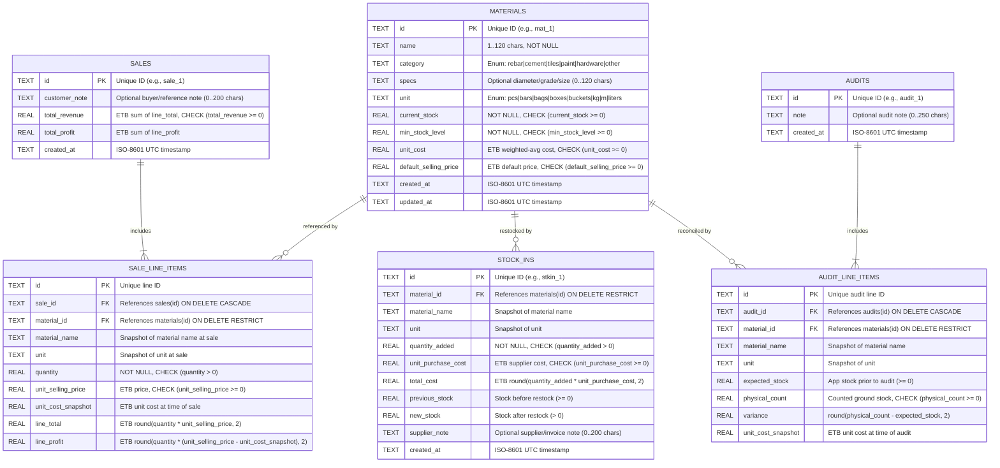

# Database Design Specification (`DATABASE_DESIGN.md`)

**Project:** Construction & Finishing Material Store Mobile ERP & Inventory Management System  
**Document Version:** 1.0  
**Source of Truth References:** `docs/PRODUCT_BRIEF.md`, `docs/SRS.md` (Section 10), `docs/ARCHITECTURE.md`

---

## 1. Database Design Overview

The persistence layer is designed around **strict ledger traceability** and **non-negative inventory invariants**:
1. **Single Tracking Unit per Material (`BR-001`):** Every material stores quantities in one canonical unit (`pcs`, `bars`, `bags`, `boxes`, `buckets`, `kg`, `m`, `liters`).
2. **Non-Negative Stock Constraint (`BR-002`):** `materials.current_stock` is strictly constrained to $\ge 0$.
3. **Immutable Historical Snapshots (`BR-007`):** Transaction records (`sale_line_items`, `stock_ins`, `audit_line_items`) snapshot the `material_name`, `unit`, and `unit_cost_snapshot` at the exact time of the event so historical revenue, cost of goods sold, and audit variance values in **Ethiopian Birr (`ETB`)** never mutate when a material is later renamed or restocked at a different supplier price.
4. **Dual-Compatible Representation:** The schema is specified both as **Normalized Relational SQLite DDL** (for Android Flutter `Drift`/`sqflite` and relational storage) and as a **Document/JSON Transactional Store** (`data/erp-store.json` on the Express server) with identical field semantics.

---

## 2. Entity Relationship Diagram (ERD)



---

## 3. Detailed Table & Collection Specifications

### 3.1 `materials` Table / Collection (`DBR-001`)
Stores the master catalog of construction and finishing materials and their current real-time stock balance.

| Column / Property | SQLite Type | JSON / TS Type | Null | Constraints & Default | Description |
| :--- | :--- | :--- | :--- | :--- | :--- |
| `id` | `TEXT` | `string` | No | `PRIMARY KEY` | Unique identifier |
| `name` | `TEXT` | `string` | No | `LENGTH(TRIM(name)) BETWEEN 1 AND 120` | Material display name (e.g., `"Deformed Rebar 12mm"`) |
| `category` | `TEXT` | `MaterialCategory` | No | `IN ('rebar','cement','tiles','paint','hardware','other')` | Material category |
| `specs` | `TEXT` | `string` | No | `DEFAULT ''`, max `120` chars | Diameter, grade, dimensions, or finish |
| `unit` | `TEXT` | `MaterialUnit` | No | `IN ('pcs','bars','bags','boxes','buckets','kg','m','liters')` | Single tracking unit (immutable once transactions exist) |
| `current_stock` / `currentStock` | `REAL` | `number` | No | `CHECK (current_stock >= 0)` | Current available stock on the ground/app |
| `min_stock_level` / `minStockLevel` | `REAL` | `number` | No | `CHECK (min_stock_level >= 0)`, `DEFAULT 0` | Low-stock alert threshold |
| `unit_cost` / `unitCost` | `REAL` | `number` | No | `CHECK (unit_cost >= 0)` | Weighted-average supplier unit cost in `ETB` |
| `default_selling_price` / `defaultSellingPrice` | `REAL` | `number` | No | `CHECK (default_selling_price >= 0)` | Default unit selling price in `ETB` |
| `created_at` / `createdAt` | `TEXT` | `string` | No | ISO-8601 timestamp | Record creation timestamp |
| `updated_at` / `updatedAt` | `TEXT` | `string` | No | ISO-8601 timestamp | Last update timestamp |

### 3.2 `sales` & `sale_line_items` Tables / Collection (`DBR-002`)
Stores completed multi-item sales transactions. In the JSON document store, `items` is an embedded array of `SaleLineItem` inside each `SaleTransaction` object; in SQLite, `sale_line_items` is a child table linked by `sale_id`.

#### Parent: `sales`
| Column / Property | SQLite Type | JSON / TS Type | Null | Constraints | Description |
| :--- | :--- | :--- | :--- | :--- | :--- |
| `id` | `TEXT` | `string` | No | `PRIMARY KEY` | Unique sale receipt ID |
| `customer_note` / `customerNote` | `TEXT` | `string` | No | `DEFAULT ''`, max `200` chars | Optional customer name or reference note |
| `total_revenue` / `totalRevenue` | `REAL` | `number` | No | `CHECK (total_revenue >= 0)` | Sum of `lineTotal` across all items (`ETB`) |
| `total_profit` / `totalProfit` | `REAL` | `number` | No | Finite number | Sum of `lineProfit` across all items (`ETB`) |
| `created_at` / `createdAt` | `TEXT` | `string` | No | ISO-8601 timestamp | Sale completion timestamp |

#### Child: `sale_line_items` (`items` array in JSON)
| Column / Property | SQLite Type | JSON / TS Type | Null | Constraints | Description |
| :--- | :--- | :--- | :--- | :--- | :--- |
| `id` | `TEXT` | `string` | Opt | `PRIMARY KEY` (SQLite) | Line item ID |
| `sale_id` | `TEXT` | `string` | No | `FOREIGN KEY REFERENCES sales(id)` | Parent sale reference |
| `material_id` / `materialId` | `TEXT` | `string` | No | `FOREIGN KEY REFERENCES materials(id)` | Sold material ID |
| `material_name` / `materialName` | `TEXT` | `string` | No | Non-empty | Snapshot of material name at sale time |
| `unit` | `TEXT` | `MaterialUnit` | No | Valid unit enum | Snapshot of material unit at sale time |
| `quantity` | `REAL` | `number` | No | `CHECK (quantity > 0)` | Quantity sold (strictly $\le$ prior `currentStock`) |
| `unit_selling_price` / `unitSellingPrice` | `REAL` | `number` | No | `CHECK (unit_selling_price >= 0)` | Actual unit selling price in `ETB` |
| `unit_cost_snapshot` / `unitCostSnapshot` | `REAL` | `number` | No | `CHECK (unit_cost_snapshot >= 0)` | Snapshot of `material.unitCost` in `ETB` at sale time |
| `line_total` / `lineTotal` | `REAL` | `number` | No | `CHECK (line_total >= 0)` | `round(quantity * unitSellingPrice, 2)` in `ETB` |
| `line_profit` / `lineProfit` | `REAL` | `number` | No | Finite number | `round(quantity * (unitSellingPrice - unitCostSnapshot), 2)` in `ETB` |

### 3.3 `stock_ins` Table / Collection (`DBR-003`)
Stores incoming supplier restocking deliveries and supplier unit purchase costs.

| Column / Property | SQLite Type | JSON / TS Type | Null | Constraints | Description |
| :--- | :--- | :--- | :--- | :--- | :--- |
| `id` | `TEXT` | `string` | No | `PRIMARY KEY` | Unique stock-in ID |
| `material_id` / `materialId` | `TEXT` | `string` | No | `FOREIGN KEY REFERENCES materials(id)` | Restocked material ID |
| `material_name` / `materialName` | `TEXT` | `string` | No | Non-empty | Snapshot of material name |
| `unit` | `TEXT` | `MaterialUnit` | No | Valid unit enum | Snapshot of tracking unit |
| `quantity_added` / `quantityAdded` | `REAL` | `number` | No | `CHECK (quantity_added > 0)` | Quantity added to inventory |
| `unit_purchase_cost` / `unitPurchaseCost` | `REAL` | `number` | No | `CHECK (unit_purchase_cost >= 0)` | Supplier unit purchase cost (`ETB`) |
| `total_cost` / `totalCost` | `REAL` | `number` | No | `CHECK (total_cost >= 0)` | `round(quantityAdded * unitPurchaseCost, 2)` (`ETB`) |
| `previous_stock` / `previousStock` | `REAL` | `number` | No | `CHECK (previous_stock >= 0)` | Material stock immediately prior to restock |
| `new_stock` / `newStock` | `REAL` | `number` | No | `CHECK (new_stock > 0)` | `round(previousStock + quantityAdded, 2)` |
| `supplier_note` / `supplierNote` | `TEXT` | `string` | No | `DEFAULT ''`, max `200` chars | Optional supplier name or delivery receipt reference |
| `created_at` / `createdAt` | `TEXT` | `string` | No | ISO-8601 timestamp | Restock timestamp |

### 3.4 `audits` & `audit_line_items` Tables / Collection (`DBR-004`)
Stores Physical Ground-Stock Audit sessions and item-level variance reconciliations.

#### Parent: `audits`
| Column / Property | SQLite Type | JSON / TS Type | Null | Constraints | Description |
| :--- | :--- | :--- | :--- | :--- | :--- |
| `id` | `TEXT` | `string` | No | `PRIMARY KEY` | Unique ground-stock audit ID |
| `note` | `TEXT` | `string` | No | `DEFAULT ''`, max `250` chars | Audit reason or summary note |
| `created_at` / `createdAt` | `TEXT` | `string` | No | ISO-8601 timestamp | Audit commit timestamp |

#### Child: `audit_line_items` (`adjustments` array in JSON)
| Column / Property | SQLite Type | JSON / TS Type | Null | Constraints | Description |
| :--- | :--- | :--- | :--- | :--- | :--- |
| `id` | `TEXT` | `string` | Opt | `PRIMARY KEY` (SQLite) | Audit line ID |
| `audit_id` | `TEXT` | `string` | No | `FOREIGN KEY REFERENCES audits(id)` | Parent audit reference |
| `material_id` / `materialId` | `TEXT` | `string` | No | `FOREIGN KEY REFERENCES materials(id)` | Audited material ID |
| `material_name` / `materialName` | `TEXT` | `string` | No | Non-empty | Snapshot of material name |
| `unit` | `TEXT` | `MaterialUnit` | No | Valid unit enum | Snapshot of tracking unit |
| `expected_stock` / `expectedStock` | `REAL` | `number` | No | `CHECK (expected_stock >= 0)` | System stock before physical audit |
| `physical_count` / `physicalCount` | `REAL` | `number` | No | `CHECK (physical_count >= 0)` | Actual physical stock counted on the ground |
| `variance` | `REAL` | `number` | No | Finite number | `round(physicalCount - expectedStock, 2)` |
| `unit_cost_snapshot` / `unitCostSnapshot` | `REAL` | `number` | No | `CHECK (unit_cost_snapshot >= 0)` | Snapshot of `material.unitCost` (`ETB`) at audit time |

---

## 4. Reference SQLite DDL Schema

```sql
PRAGMA foreign_keys = ON;

CREATE TABLE IF NOT EXISTS materials (
    id TEXT PRIMARY KEY NOT NULL,
    name TEXT NOT NULL CHECK (length(trim(name)) BETWEEN 1 AND 120),
    category TEXT NOT NULL CHECK (category IN ('rebar', 'cement', 'tiles', 'paint', 'hardware', 'other')),
    specs TEXT NOT NULL DEFAULT '' CHECK (length(specs) <= 120),
    unit TEXT NOT NULL CHECK (unit IN ('pcs', 'bars', 'bags', 'boxes', 'buckets', 'kg', 'm', 'liters')),
    current_stock REAL NOT NULL CHECK (current_stock >= 0),
    min_stock_level REAL NOT NULL DEFAULT 0 CHECK (min_stock_level >= 0),
    unit_cost REAL NOT NULL CHECK (unit_cost >= 0),
    default_selling_price REAL NOT NULL CHECK (default_selling_price >= 0),
    created_at TEXT NOT NULL,
    updated_at TEXT NOT NULL
);

CREATE INDEX IF NOT EXISTS idx_materials_category ON materials(category);
CREATE INDEX IF NOT EXISTS idx_materials_low_stock ON materials(current_stock, min_stock_level);

CREATE TABLE IF NOT EXISTS sales (
    id TEXT PRIMARY KEY NOT NULL,
    customer_note TEXT NOT NULL DEFAULT '' CHECK (length(customer_note) <= 200),
    total_revenue REAL NOT NULL CHECK (total_revenue >= 0),
    total_profit REAL NOT NULL,
    created_at TEXT NOT NULL
);

CREATE INDEX IF NOT EXISTS idx_sales_created_at ON sales(created_at DESC);

CREATE TABLE IF NOT EXISTS sale_line_items (
    id TEXT PRIMARY KEY NOT NULL,
    sale_id TEXT NOT NULL REFERENCES sales(id) ON DELETE CASCADE,
    material_id TEXT NOT NULL REFERENCES materials(id) ON DELETE RESTRICT,
    material_name TEXT NOT NULL,
    unit TEXT NOT NULL,
    quantity REAL NOT NULL CHECK (quantity > 0),
    unit_selling_price REAL NOT NULL CHECK (unit_selling_price >= 0),
    unit_cost_snapshot REAL NOT NULL CHECK (unit_cost_snapshot >= 0),
    line_total REAL NOT NULL CHECK (line_total >= 0),
    line_profit REAL NOT NULL
);

CREATE INDEX IF NOT EXISTS idx_sale_items_sale_id ON sale_line_items(sale_id);
CREATE INDEX IF NOT EXISTS idx_sale_items_material_id ON sale_line_items(material_id);

CREATE TABLE IF NOT EXISTS stock_ins (
    id TEXT PRIMARY KEY NOT NULL,
    material_id TEXT NOT NULL REFERENCES materials(id) ON DELETE RESTRICT,
    material_name TEXT NOT NULL,
    unit TEXT NOT NULL,
    quantity_added REAL NOT NULL CHECK (quantity_added > 0),
    unit_purchase_cost REAL NOT NULL CHECK (unit_purchase_cost >= 0),
    total_cost REAL NOT NULL CHECK (total_cost >= 0),
    previous_stock REAL NOT NULL CHECK (previous_stock >= 0),
    new_stock REAL NOT NULL CHECK (new_stock > 0),
    supplier_note TEXT NOT NULL DEFAULT '' CHECK (length(supplier_note) <= 200),
    created_at TEXT NOT NULL
);

CREATE INDEX IF NOT EXISTS idx_stock_ins_created_at ON stock_ins(created_at DESC);
CREATE INDEX IF NOT EXISTS idx_stock_ins_material_id ON stock_ins(material_id);

CREATE TABLE IF NOT EXISTS audits (
    id TEXT PRIMARY KEY NOT NULL,
    note TEXT NOT NULL DEFAULT '' CHECK (length(note) <= 250),
    created_at TEXT NOT NULL
);

CREATE INDEX IF NOT EXISTS idx_audits_created_at ON audits(created_at DESC);

CREATE TABLE IF NOT EXISTS audit_line_items (
    id TEXT PRIMARY KEY NOT NULL,
    audit_id TEXT NOT NULL REFERENCES audits(id) ON DELETE CASCADE,
    material_id TEXT NOT NULL REFERENCES materials(id) ON DELETE RESTRICT,
    material_name TEXT NOT NULL,
    unit TEXT NOT NULL,
    expected_stock REAL NOT NULL CHECK (expected_stock >= 0),
    physical_count REAL NOT NULL CHECK (physical_count >= 0),
    variance REAL NOT NULL,
    unit_cost_snapshot REAL NOT NULL CHECK (unit_cost_snapshot >= 0)
);

CREATE INDEX IF NOT EXISTS idx_audit_items_audit_id ON audit_line_items(audit_id);
CREATE INDEX IF NOT EXISTS idx_audit_items_material_id ON audit_line_items(material_id);
```

---

## 5. Transactional Integrity & Concurrency Rules

1. **Multi-Item Sale Transaction (`POST /api/sales`):**
   - Must execute inside a single atomic transaction:
     1. Aggregate requested quantities by `materialId` (`BR-003`).
     2. Verify every referenced `materialId` exists and `aggregatedQuantity <= material.currentStock` (`BR-002`, `VAL-005`).
     3. If any check fails, abort/rollback the entire transaction without modifying any row (`FAIL-004`).
     4. Deduct `quantity` from `materials.current_stock`, update `materials.updated_at`, insert the `sales` record and its `sale_line_items`, and commit.
2. **Stock-In Transaction (`POST /api/stock-in`):**
   - Must execute inside a single atomic transaction:
     1. Compute `newUnitCost` via the weighted-average cost formula (`BR-006`):
        $$\text{newUnitCost} = \begin{cases} \text{unitPurchaseCost} & \text{if } \text{previousStock} = 0 \\ \text{round}\left(\frac{(\text{previousStock} \times \text{oldUnitCost}) + (\text{quantityAdded} \times \text{unitPurchaseCost})}{\text{previousStock} + \text{quantityAdded}}, 2\right) & \text{if } \text{previousStock} > 0 \end{cases}$$
     2. Increment `materials.current_stock` to `previousStock + quantityAdded` and set `materials.unit_cost = newUnitCost`.
     3. Insert the `stock_ins` record and commit.
3. **Ground-Stock Audit Transaction (`POST /api/audits`):**
   - Must execute inside a single atomic transaction:
     1. For each audited item, compute `variance = round(physicalCount - currentStock, 2)`.
     2. Set `materials.current_stock = physicalCount` and update `materials.updated_at`.
     3. Insert the `audits` record and its `audit_line_items`, and commit.

---

## 6. Authentication, Categories, Archiving & Reversal Extensions

1. **`users` Collection / Table:**
   - `id` (`TEXT PRIMARY KEY`), `username` (`TEXT UNIQUE NOT NULL`), `email` (`TEXT`), `displayName` (`TEXT NOT NULL`), `passwordHash` (`TEXT NOT NULL` — `scrypt$<salt>$<derivedKey>`), `role` (`'admin' | 'staff'`), `isActive` (`BOOLEAN NOT NULL DEFAULT 1`), `createdAt`, `updatedAt`.
   - Never exposed with `passwordHash` in `/api/state` or `/api/users` responses (`PublicUser` projection).
   - **Last Active Admin Invariant:** The system strictly prohibits deleting or deactivating the last active `admin` user (`409 LAST_ADMIN_PROTECTION`).
2. **`categories` Collection / Table:**
   - `id` (`TEXT PRIMARY KEY`), `label` (`TEXT NOT NULL`), `isSystem` (`BOOLEAN`), `createdAt`.
   - Deletion (`DELETE /api/categories/:id`) is allowed only when zero materials reference `category == id` (`409 CATEGORY_IN_USE` otherwise).
3. **`materials` Archive Extension:**
   - `isArchived` (`BOOLEAN DEFAULT 0`), `archivedAt` (`TEXT`).
   - Materials with zero transaction history (`sales`, `stockIns`, `audits`) may be permanently deleted (`DELETE /api/materials/:id`). Materials referenced in any historical transaction cannot be permanently deleted (`409 MATERIAL_HAS_HISTORY`) and must be archived (`POST /api/materials/:id/archive`).
4. **Ledger Reversal Metadata (`sales`, `stock_ins`, `audits`):**
   - Completed ledger transactions are never permanently deleted (`409 DELETION_PROHIBITED`).
   - Each transaction supports a one-time atomic reversal (`isReversed: true`, `reversedAt`, `reversedBy`, `reversalReason`, and `previousUnitCost` on `stock_ins`), restoring inventory balances accurately while preserving the immutable original record.

